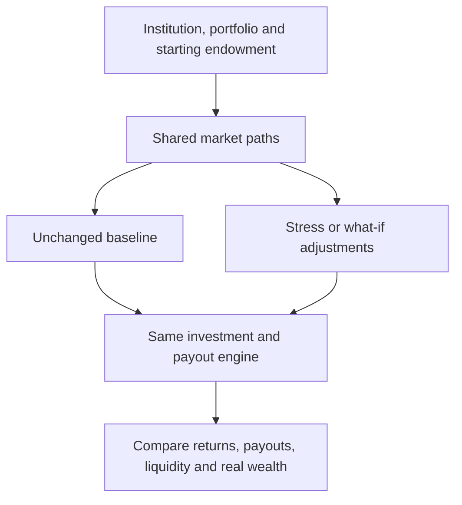

**CURRENT INPUTS (15 Nov 2026):** This document includes descriptions inherited from earlier development versions. The authoritative current portfolio inputs are the ten Static/Dynamic strategies supplied by the Research 1 November handoff, with Calm/Turbulent regime targets, 13 asset classes, and updated portfolio-specific liquidity/capital-call proxies. For all current portfolio, stress and payout measure definitions, FIRST read `UPDATED_R1_HANDOFF_AND_PAYOUT_RISKS.md`. Previously reported nine-strategy simulation results are superseded, not comparable without rerunning.

---

# Endowment Planning & Risk — Model Guide

## Purpose

The model asks whether an investment strategy can support planned university
payouts, maintain liquidity and preserve purchasing power over 2027–2031.
Both Private and Public cases start from the selected endowment amount, normally
$150 million, and use the supplied institutional benchmark profiles.

Stress testing asks what could happen under specified adverse conditions.
What-if analysis asks how changing a policy or assumption changes the outcome.
Neither assigns a probability to the scenario itself.

## The calculation framework

1. Generate 20 quarterly observations using circular four-quarter blocks of the
   existing joint asset-return and inflation history.
2. Apply a scenario to the underlying asset returns, inflation or explicit
   institutional assumptions. Historical replay quarters replace sampled quarters.
3. Invest the payout-eligible and restricted-gift pools separately, using the
   existing quarterly target and trading rules. The initial allocation is the
   existing High Inflation allocation. The first baseline quarter retains it.
4. Calculate the planned annual payout from the three-year average of total
   endowment values, bounded by 3%–5% of opening total wealth.
5. Add gifts at year-end to the restricted pool. Raise eligible cash through
   asset sales, net of costs, and execute the annual funding waterfall.
6. Record balances, realized investment returns, payout gaps, liquidity and
   inflation-adjusted values. Repeat for each matched path and comparison case.

The simplified model is the controlling financial framework. The older model
supplies stress data and scenario ideas; its alternative deterministic path
engine, borrowing choices and spending frameworks are not imported.

## Policies retained

| Policy | Treatment |
|---|---|
| Projection | Five years, 2027–2031 |
| Paths | 5,000 or 10,000 per case; seed 42 |
| Prior values | Both pre-projection endowment observations equal starting wealth |
| Spending | Three-year average; 3% floor and 5% ceiling, both measured against opening total wealth |
| Gift timing | Year-end, with investment returns starting the following year |
| Gift eligibility | All new gifts and their returns are restricted during the projection |
| Planned-payout base | Includes total wealth, including accumulated restricted gifts, as in the simplified model |
| Payout funding | Eligible cash first, then asset sales available within three months, after sale costs |
| Reserve | Strategy-specific baseline reserve, protected during funding; changed only in an explicit what-if scenario |
| Capital calls | Strategy-specific net cash-demand proxies; cash transfers into private holdings, rather than a loss of total wealth |
| Other obligations | None specified; no borrowing or separate private-investment distributions |

For the three main strategies:

| Strategy | Annual baseline call rate / opening total wealth | Call years | Protected reserve |
|---|---:|---|---:|
| Hierarchical Risk Parity | 3.0356% | Years 1–3 | 1.00 annual payout |
| Minimum Variance | 0.7813% | Years 1–3 | 1.00 annual payout |
| Mean–Conditional Value at Risk | 5.1599% | Years 1–3 | 1.00 annual payout |

These are supplied research proxies, not observed normal-year commitments.
In the severe downturn/liquidity cases, the rate is **1.5 times** the baseline
rate for years 1–4. It replaces that schedule; it is not added on top. This is
consistent with the supplied scaling from 2% to 3% of a reference private
allocation. The baseline reserve remains protected; severe stress does not
silently release it.

Unpaid calls are reported but are not carried forward as debt or overdue
commitments. No default penalty or private-asset write-down is attached to them.

## Main stress tests

| Assumption | Standard high inflation | Severe high inflation |
|---|---|---|
| Historical start | 2022Q1–Q4 | 2022Q1–Q4 |
| Later return adjustment | −2 percentage points per year for 3 years | −4 points per year for 4 years |
| Later inflation adjustment | +1.6 percentage points for 3 years | +2.4 points for 4 years |
| Operating expenses | Supplied standard growth stress, first year | Supplied severe growth stress, first year |

The replay is not adjusted again by the later return or inflation overlays.
Annual return adjustments are divided by four and added to each asset's
quarterly return; the realized annual change is not exactly the headline
arithmetic adjustment because returns compound. Inflation adjustments add to
annualized quarterly inflation and are converted back into quarterly price-index
changes before annual compounding. Historical asset/inflation relationships
resume outside the specified windows; no extra transition model is introduced.

| Assumption | Standard prolonged downturn | Severe prolonged downturn |
|---|---|---|
| Historical start | 2008Q1–2009Q2 | 2008Q1–2009Q2 |
| Later return adjustment | −3 points per year for 2 years | −4 points per year for 3 years |
| Gifts | Supplied standard reduction | Supplied severe reduction |
| Calls | Baseline rate, years 1–3 | 1.5× baseline rate, years 1–4 |
| Sale conditions | Stressed timing and midpoint costs in years 1–2 | Same, plus emerging-market and high-yield sales frozen in years 1–2 |
| Cash reserve | Baseline reserve retained | Baseline reserve retained |

Recovery adjustments begin immediately after the six-quarter replay. This may
be midyear. Annual gift and liquidity assumptions begin in projection year one.
Any window reaching the end of 2031 is clipped at that date.

The asset freeze applies to annual sales **and quarterly rebalancing**, including
assets available to pay trading costs. This prevents a frozen asset from being
sold earlier in the year to manufacture year-end cash. Other asset-specific
liquidity and rebalancing constraints continue to apply.

## Institution-specific stress assumptions

These values come from the stress table supplied with the older model:

| Institution | Severity | Expense growth in first stress year | Gift rate multiplier | Gift reduction years |
|---|---|---:|---:|---:|
| Private | Standard | 9.45% | 0.87 | 1 |
| Private | Severe | 12.53% | 0.57 | 2 |
| Public | Standard | 6.27% | 0.84 | 1 |
| Public | Severe | 9.66% | 0.56 | 2 |

Gift multipliers apply to the existing gift rate and beginning-year wealth.
Afterwards the baseline gift rate resumes; prior missed gifts are not replenished.
For expense growth, the simplified engine applies the first-year stress as a
ratio of (1 + stressed growth) to (1 + baseline growth), then resumes normal
growth from that higher expense level. Operating expense stress increases
required support; it does not automatically force a larger endowment payout.

## Other stress tests

- **Recession at the start:** replace the first six observations with joint
  asset/inflation draws from recession quarters and use recession allocation
  targets; subsequent matched bootstrap observations are unchanged.
- **Five years of weak returns:** subtract 1.25 percentage points from each
  quarterly asset return for all 20 quarters. The name reflects the actual
  five-year horizon rather than implying a ten-year simulation.
- **Stagflation:** all five years have weak returns and higher inflation, plus
  the first-year expense stress. Standard: −3 return points and +2 inflation
  points. Severe: −4 return points and +3 inflation points.
- **Lower gifts:** isolate the institutional gift reduction above.
- **Liquidity pressure only:** stressed timing/costs for one year (standard) or
  two years (severe). Severe calls last four years and emerging-market/high-yield
  sales are frozen for two years. Normal cases keep the baseline call schedule.
- **Sudden market shock:** apply the supplied joint-window asset shock vector
  multiplicatively to the first sampled quarter. Standard and severe vectors
  are in `data/investment/market_shocks.csv`. They compress a longer drawdown into
  an illustrative instantaneous event; they are not historical quarterly returns.
- **Historical replays:** 2008Q1–2009Q2, 2020Q1–Q2 or 2022Q1–Q4. Replay joint
  asset returns and inflation, retaining today's model policies. No strategy
  return is added to the asset returns a second time.

The severity selector changes the main tests, stagflation, gift/liquidity tests
and the sudden shock. It does not rescale historical returns, the six-quarter
recession duration or the fixed weak-return assumption.

## What-if tests

Preset comparisons include 4% or 5% spending, no gifts, 25% more gifts,
half-year or 1.5-year cash reserves, and the supplied Low and High institutional
profiles. The 3%–5% spending collar remains binding even when the rate changes.
Low and High profiles combine parameter percentiles and are not automatically
worst- or best-case scenarios.

Custom cases allow changes to returns, inflation, gifts, spending, reserves,
call multipliers and a public-asset freeze. The selected shock duration controls
returns, inflation, gifts, spending and the freeze. The cash reserve applies
throughout; the call multiplier applies to the baseline three-year schedule.
Unspecified inputs are unchanged. Zero-value custom overlays reproduce baseline
when the selected reserve also equals the strategy's baseline reserve.

## Definitions

All amounts are **USD millions**. Real amounts are expressed in beginning-of-
projection purchasing power using the path's compounded inflation index.

- **Investment return:** quarterly holdings performance, including modeled
  rebalancing costs, compounded into annual returns and a five-year CAGR. Direct
  gift receipts and payout withdrawals are excluded. Payout asset-sale costs are
  deducted separately from wealth; full management fees remain excluded.
- **Unpaid payout probability:** fraction of paths with at least one actual
  payout below planned payout by more than the numerical tolerance.
- **Average unpaid payout when positive:** mean gap over path-years with an
  unpaid payout; zero when there are no such events.
- **Liquid share:** stressed one-month liquidity-weighted payout-eligible
  assets divided by total endowment, including restricted gifts. The same
  numerator and observation dates are used for the 40% and 20% tests.
- **Liquidity buffer:** those liquid assets divided by the year's planned
  payout. The chart shows post-payout year-end medians; the minimum-buffer
  statistic uses the lowest observed buffer in each path before taking the median.
- **Funding capacity:** net three-month cash capacity after prioritized
  obligations and the protected reserve. It is not the one-month liquidity buffer.
- **Purchasing-power expected shortfall (95%):** mean of the worst 5% of
  nonnegative losses `max(0, 1 − terminal real wealth / initial wealth)`.
- **Institutional support gap:** `max(0, required support − actual payout)`;
  it is distinct from a planned payout going unpaid.
- **Earnings coverage gap:** a comparison of investment earnings and planned
  payout. It does not imply that sufficient cash cannot be raised from asset sales.

The displayed probability change is scenario probability minus baseline
probability, in **percentage points**. The change in median terminal wealth is
the difference of medians. The mean paired change first subtracts terminal
wealth on each matched path and then averages; these are different statistics.

## Comparison integrity and interpretation

A single vector of explicit market-path seeds is generated and reused for every
case. Strategy-specific cash decisions consume no random market draws. Overlays
replace only the documented quarters or assumptions. Baseline and scenarios use
the same initialization, horizon, simulation count, accounting and summaries.
A standalone baseline now uses the same seed vector as comparisons. This can
change results relative to an earlier standalone run even though the financial
calculations are unchanged. Exact parity was checked using identical path seeds.

Negative market conditions may lower future planned payouts because they reduce
the valuation base. Consequently, a severe stress can reduce wealth substantially
while still producing few unpaid payouts. Read wealth, delivered payouts and
liquidity together; do not infer resilience from one probability alone.

More gifts can increase restricted wealth and future planned payouts without
increasing eligible cash. The no-gift comparison reveals that interaction; it is
not merely total assets minus the ending gift pool.

## Limitations

- Scenarios are supplied research assumptions or documented illustrative
  combinations. They are not calibrated crisis forecasts or actual university
  funding commitments.
- Historic returns, including supplied backfills and private-asset proxies,
  may understate or misrepresent future liquidity and investment risk.
- Rebalancing, liquidity gates, notices, calls and payouts are simplified.
  Annual execution does not simulate every intra-year funding date.
- Sale costs use supplied midpoint estimates; severe cases do not automatically
  switch to upper-end transaction costs. The one-month liquidity weights remain
  the supplied conservative monitor.
- Capital calls are net cash-demand proxies. No distributions, unfunded
  commitment ledger, overdue-call debt, manager default or borrowing is modeled.
- All new gifts and their growth are restricted by assumption. Donor-specific
  legal permissions are not available.
- Management fees are incomplete. A fair comparison to a passive 70/30 portfolio
  still requires comparable return data and a consistent fee convention.
- Transaction-size limits in the source liquidity data do not establish validity
  for much larger endowments. The primary illustrations remain $150 million.
- Full production validation covers Private/Base/HRP and the two main severe
  tests; other combinations have smaller automated validation runs.

## Quarterly rebalancing when holdings become illiquid
Quarterly target allocations are aims, not mandatory forced-liquidation orders. The model does not redeem locked private equity/venture capital, or restricted hedge funds, to fund rebalancing trades. If locked-asset purchases would exceed the movable part of the portfolio, they are capped. If liquid holdings cannot cover the required asset-specific transaction costs, the proposed trade is proportionally scaled or deferred. The simulated portfolio then earns the next quarter’s returns on its *actual* holdings. This is distinct from the year-end test of whether university payouts can be funded. See `REBALANCING_FIX.md`.

## Updated stress diagnostics and hypothetical policy responses

The stress screen reports changes in annualized return, unpaid distributions, liquidity-buffer multiples, terminal purchasing-power Expected Shortfall and real spendable wealth against the **same-strategy, same-path baseline**. Funding failures and eligible-earnings deficits remain separate events.

The policy-response screen holds the **same shock and market draw** fixed while varying **only the spending rate or the reserve target**: Private spending can be fixed at 4%, Public at 3.5%, or protected reserves can be adjusted to 0.5× or 1.5× annual planned payout. The original 3%-5% annual spending collar continues to apply. These are policy scenarios, not a trading recommendation, and the model does not implement a trigger that automatically cuts spending after a liquidity breach.

The corresponding stress diagnostics chart planned versus actual distributions, mean unpaid payouts, the per-year probability of funding failure, investment returns, endowment purchasing power, payout-eligible asset values, and remaining stressed one-month liquid assets relative to annual planned payout. Scenario-conditioned funding shortfalls should not be confused with the unconditional probability that a particular crisis occurs.

See `STRESS_POLICY_UPDATES.md` for exact definitions, data lineage, limitations, and validation instructions.
